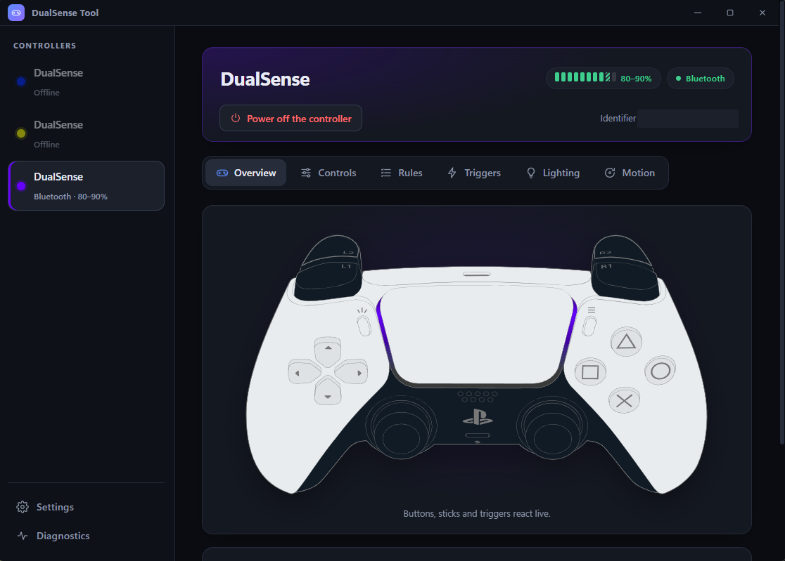
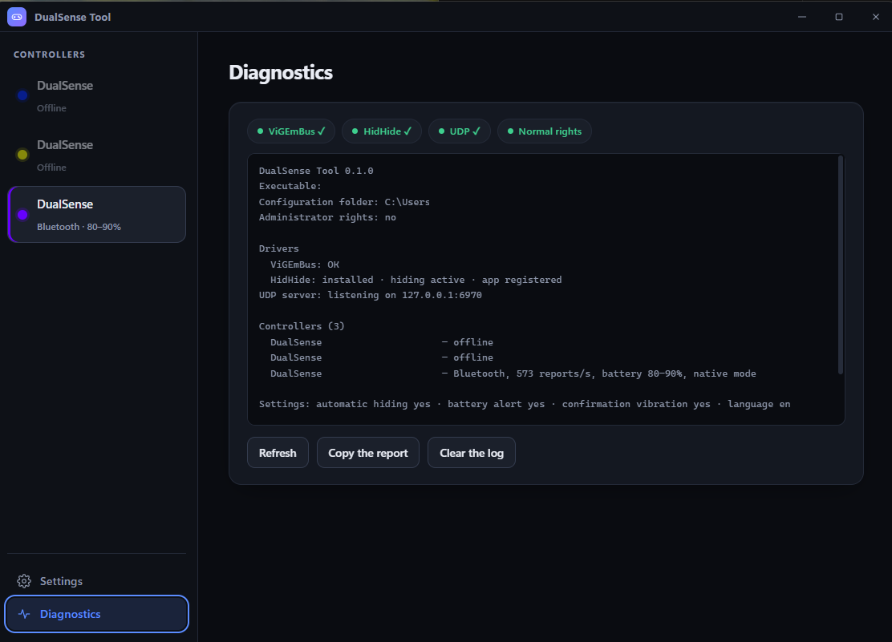

# DS5Forge

A companion application for the Sony DualSense controller on Windows, built with Rust and
[Tauri](https://tauri.app). English | [Français](README.fr.md)





## Features

- **Native use**: the controller works as a regular DualSense, with its own settings saved per controller. Everything below is optional.
- **Live view** of the controller: buttons, sticks, triggers, touchpad, battery and connection type.
- **Adaptive triggers** (resistance, weapon click, vibration), **rumble**, **light bar** (fixed colour,
  following the battery or following the mode) and **player LEDs**.
- **Optional Xbox 360 mode**: a virtual controller (through [ViGEmBus](https://github.com/nefarius/ViGEmBus)), with the
  physical controller optionally hidden from games through [HidHide](https://github.com/nefarius/HidHide).
- **Rules**: remap buttons, combinations and stick directions to Xbox buttons, keyboard keys and mouse
  actions; gestures (short press, hold, double press, while held), macros, turbo, latching and layers.
- **Analog bindings**: a stick can drive the mouse, the scroll wheel or keys.
- **Gyroscope and touchpad** as a mouse or as the right stick.
- **Overlay** with the battery level and the mode of every controller, a **notification-area icon**,
  low-battery alerts and haptic confirmations.
- **UDP interface** to control the lighting, triggers and rumble from other programs (see [UDP.md](UDP.md)).
- **Diagnostics** page to check drivers, rights, each controller and the event log.
- **English and French** interface, switchable at any time in *Settings → Language*. By default the
  language of the system is used.

## Installation

Download `DS5Forge_<version>_x64-setup.exe` from the [Releases](../../releases) page and run it. It
installs for the current user only (no administrator rights needed) and offers English or French.

The installer is not code-signed, so Windows SmartScreen may show a warning the first time: choose
*More info* → *Run anyway*.

## Requirements

- Windows 10 or 11.
- Optional, for the virtual controller: [ViGEmBus](https://github.com/nefarius/ViGEmBus). Both optional drivers can be installed from *Settings → Components* (through winget).
- Optional, to hide the physical controller from games: [HidHide](https://github.com/nefarius/HidHide).
  Hiding needs the application to be the only program using HidHide at that moment (close the HidHide
  Configuration Client and other controller tools), and may need administrator rights.

## Building

Prerequisites: [Rust](https://rustup.rs), [Node.js](https://nodejs.org) and the
[Tauri prerequisites for Windows](https://tauri.app/start/prerequisites/).

```bash
npm install
npm run tauri dev     # development build with live reload
npm run tauri build   # installer in src-tauri/target/release/bundle
```

Checks:

```bash
cd src-tauri && cargo test    # backend unit tests
npx tsc --noEmit              # type-check the interface
```

To publish a release, push a tag (`git tag v0.1.0 && git push origin v0.1.0`): the *Release* workflow builds
the installer and attaches it to a draft release. To build it locally, run `npm run tauri build`; the installer is
written to `src-tauri/target/release/bundle/nsis/`.

## Project layout

| Path | Content |
|---|---|
| `src-tauri/src/` | Rust backend: HID reports, rules engine (`bindings.rs`), virtual controller, HidHide, UDP server |
| `src-tauri/src/i18n.rs` | Messages produced by the backend, in English and French |
| `src/` | TypeScript interface (Vite, no framework) |
| `src/locales/` | Interface texts: `en.ts` is the reference, `fr.ts` must provide the same keys |
| `src/assets/` | Controller illustration (see [its README](src/assets/README.md)) |
| `tools/` | Script that converts Sony's artwork into the SVG used by the interface |
| `examples/` | A small UDP client |

## Adding a language

1. Copy `src/locales/en.ts` to a new file and translate the values (the compiler checks that no key is missing).
2. Register the dictionary and the language name in `src/i18n.ts`.
3. Add the matching variant to `Lang` and the translations of the `Msg` messages in `src-tauri/src/i18n.rs`
   (the keyboard key labels are in `src-tauri/src/keys.rs`).

## Licence

The code is released under the [MIT licence](LICENSE). The controller artwork in `src/assets/` is derived
from Sony Interactive Entertainment material and is not covered by it (see [its README](src/assets/README.md)).

## Trademarks

DualSense and PlayStation are trademarks of Sony Interactive Entertainment. Xbox is a trademark of
Microsoft. This project is not affiliated with either company.
